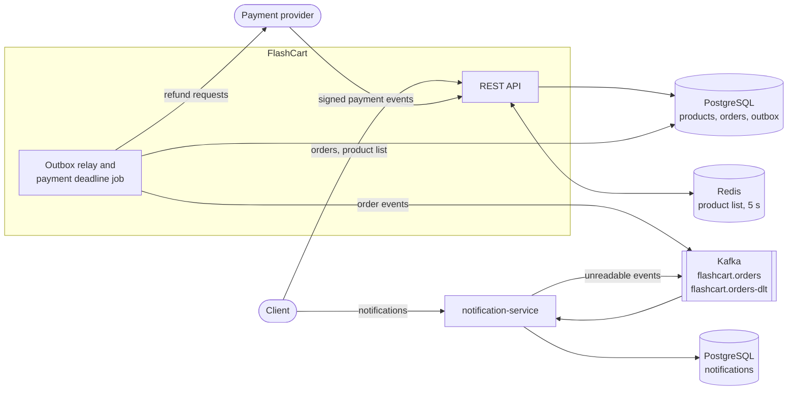

# FlashCart

FlashCart is an order API for flash sales, built with Spring Boot, PostgreSQL, Kafka and Redis. I built it to cover what goes wrong when many customers try to buy the same product at the same moment: overselling, orders placed twice, payment events that arrive twice or too late, and events lost between the database and the message broker.

[](https://github.com/hmzckd/flashcart/actions/workflows/ci.yml)

## What it includes

- Orders that never oversell, with a row lock by default and optimistic locking as an option
- An `Idempotency-Key` header, so a retried order request places one order
- Order statuses (pending, paid, shipped, cancelled), with the stock returned on cancel
- Signed payment events (HMAC-SHA256), each applied once
- Refund requests sent to the payment provider through an outbox, with retries
- Order events published to Kafka through the same outbox
- A separate notification service that applies each order event once
- Unpaid orders cancelled automatically after a 15 minute payment deadline
- The product list cached in Redis for 5 seconds
- Integration tests with Testcontainers (PostgreSQL, Kafka, Redis) and a k6 load test

## How it fits together



A change to an order and the messages it causes (an order event, a refund request) are written to PostgreSQL in one transaction, so nothing is sent for a change that was rolled back. The outbox relay sends the messages afterwards: order events are retried until Kafka accepts them, and refund requests are tried five times and then marked `FAILED`.

## Stack

| Area | Technology |
| --- | --- |
| API | Spring Boot 4.1 (Spring MVC) on Java 21 |
| Database | PostgreSQL 17, Spring Data JPA, Flyway |
| Messaging | Apache Kafka 4.2 |
| Cache | Redis 8 with Spring Cache |
| Tests | JUnit 6, Testcontainers, WireMock |
| Load test | k6 |
| CI | GitHub Actions |

## Repository layout

```text
.
├── src/main/java/com/hmzckd/flashcart/
│   ├── product/              products and the product list cache
│   ├── order/                orders, stock locking, statuses, idempotency keys, payment deadline
│   ├── payment/              payment events, signature check, refund requests
│   └── outbox/               outbox messages and the relay
├── src/main/resources/db/migration/   Flyway migrations
├── src/test/                 unit and Testcontainers integration tests
├── notification-service/     separate Spring Boot app that reads order events
├── load-test/                k6 scripts
├── docs/adr/                 architecture decision records
├── docs/load-test.md         load test steps and results
├── GLOSSARY.md               domain terms
├── compose.yaml              PostgreSQL, Kafka and Redis for local runs
└── .github/workflows/ci.yml
```

## Run locally

### Requirements

- JDK 21 or newer (the Maven wrapper is included)
- Docker Desktop

### 1. Start PostgreSQL, Kafka and Redis

```powershell
docker compose up -d
```

FlashCart's database listens on `localhost:5433` and the notification service's on `localhost:5434`. The first migration adds two products.

### 2. Configure the payment provider

The committed configuration contains no secret, and FlashCart refuses to start without one. Set local values:

```powershell
$env:PAYMENT_SIGNING_SECRET = "local-secret"
$env:PAYMENT_PROVIDER_URL = "http://localhost:8089"
$env:PAYMENT_API_KEY = "local-api-key"
```

`PAYMENT_SIGNING_SECRET` checks the signature of incoming payment events. The other two are where refund requests go. Nothing listens on port 8089 locally, so refund requests are retried and then marked `FAILED`.

### 3. Start the API

```powershell
.\mvnw.cmd spring-boot:run
```

The API listens on `http://localhost:8080`.

### 4. Start the notification service

In a second window, after FlashCart has started (it creates the Kafka topic):

```powershell
.\mvnw.cmd -f notification-service\pom.xml spring-boot:run
```

It listens on `http://localhost:8081`.

### 5. Place and cancel an order

In a third window:

```powershell
Invoke-RestMethod http://localhost:8080/api/products
$order = Invoke-RestMethod -Method Post -Uri http://localhost:8080/api/orders -ContentType "application/json" -Headers @{ "Idempotency-Key" = [guid]::NewGuid().ToString() } -Body '{"productId": 1, "quantity": 1}'
Invoke-RestMethod -Method Post -Uri "http://localhost:8080/api/orders/$($order.id)/cancel"
Invoke-RestMethod "http://localhost:8081/api/notifications?orderId=$($order.id)"
```

The last call lists `Order N was placed` and `Order N was cancelled` once the relay has sent the events, usually within a few seconds.

## Checks

Docker must be running, because the integration tests start their own containers:

```powershell
.\mvnw.cmd test
.\mvnw.cmd -f notification-service\pom.xml test
```

## API overview

| Method | Route | Purpose |
| --- | --- | --- |
| GET | `/api/products` | List products (cached for 5 seconds) |
| POST | `/api/orders` | Place an order, optional `Idempotency-Key` header |
| GET | `/api/orders/{id}` | Get an order |
| POST | `/api/orders/{id}/ship` | Ship a paid order |
| POST | `/api/orders/{id}/cancel` | Cancel a pending or paid order |
| GET | `/api/orders/{id}/refunds` | List an order's refunds |
| POST | `/api/payments/events` | Payment event from the provider, `Payment-Signature` header |
| GET | `/api/ping` | Health check |
| GET | `/api/notifications?orderId={id}` | Notifications for an order (notification service, port 8081) |

FlashCart's own errors are returned as `application/problem+json`: 400 for invalid input, 401 for a bad payment signature, 404 for an unknown product or order, 409 for insufficient stock, a status change that is not allowed, or too many colliding orders under optimistic locking, and 422 for an idempotency key reused with a different product or quantity.

## Notification service

`notification-service/` is a separate Spring Boot app with its own PostgreSQL database (`localhost:5434`). It reads `flashcart.orders` as the consumer group `notification-service` and stores one notification per order event, such as "Order 5 was shipped". A repeated event is skipped by its `eventId`. An event it cannot read is tried 3 times and then moved to `flashcart.orders-dlt`, so the events behind it are not held up. `GET http://localhost:8081/api/notifications?orderId=5` lists an order's notifications.

## Design decisions

Each decision has a short record in [`docs/adr/`](docs/adr/) with its reasons and consequences.

| ADR | Decision |
| --- | --- |
| [0001](docs/adr/0001-lock-the-product-row-while-placing-an-order.md) | Placing an order locks the product row, so two orders cannot sell the same unit |
| [0002](docs/adr/0002-optimistic-locking-as-an-option.md) | Optimistic locking with retries is available, pessimistic stays the default |
| [0003](docs/adr/0003-optimistic-locking-for-order-status-changes.md) | A version number on each order stops two status changes from both applying |
| [0004](docs/adr/0004-apply-each-payment-event-once-with-an-insert-first-unique-key.md) | Each payment event id is inserted first, so a repeated event is applied once |
| [0005](docs/adr/0005-send-refunds-to-the-payment-provider-through-an-outbox.md) | Refund requests leave through an outbox and are retried with backoff |
| [0006](docs/adr/0006-publish-order-events-to-kafka-through-the-outbox.md) | Order events reach Kafka through the same outbox, keyed by order |
| [0007](docs/adr/0007-notification-service-applies-each-order-event-once.md) | The notification service has its own database, skips repeated events, and moves unreadable ones to a dead-letter topic |
| [0008](docs/adr/0008-place-each-order-once-per-idempotency-key.md) | A repeated idempotency key returns the first order instead of placing a second one |
| [0009](docs/adr/0009-cancel-unpaid-orders-after-a-payment-deadline.md) | A scheduled job cancels orders that are not paid within 15 minutes |
| [0010](docs/adr/0010-cache-the-product-list-in-redis-for-five-seconds.md) | The product list is cached in Redis for 5 seconds; orders never read the cache |

## Load test

k6 scripts in [`load-test/`](load-test/), with the steps and all numbers in [`docs/load-test.md`](docs/load-test.md). Measured on one 4-CPU machine running the app, PostgreSQL, Kafka, Redis and k6 together:

| Scenario | Result |
| --- | --- |
| 5,000 orders from 200 users for one product with 100 units | Exactly 100 sold in all 8 runs, with both locking modes, and no errors |
| Product list, 100 users for 30 seconds, with the Redis cache | 11,467 to 12,267 requests/s, p95 under 19 ms, 257 to 361 database queries |
| The same without the cache | 3,660 to 4,768 requests/s, p95 50 to 77 ms, 107,680 to 142,275 database queries |

## Roadmap

- A circuit breaker that skips Redis for a while after errors
- Endpoints to add and change products, which clear the cached list
- Customer accounts and authentication
- A reminder before the payment deadline
- Running the load test against a deployed environment
